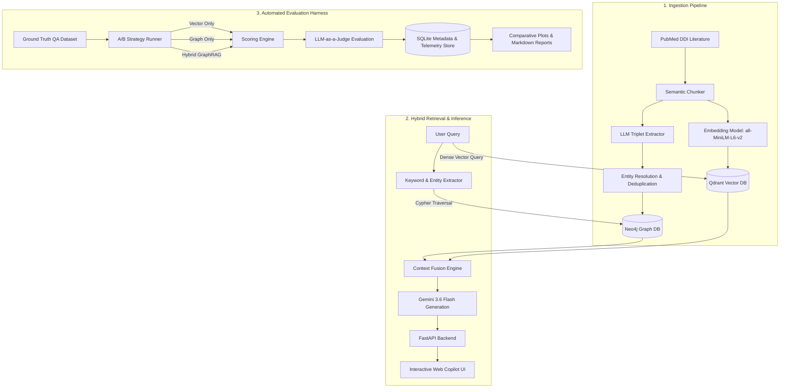
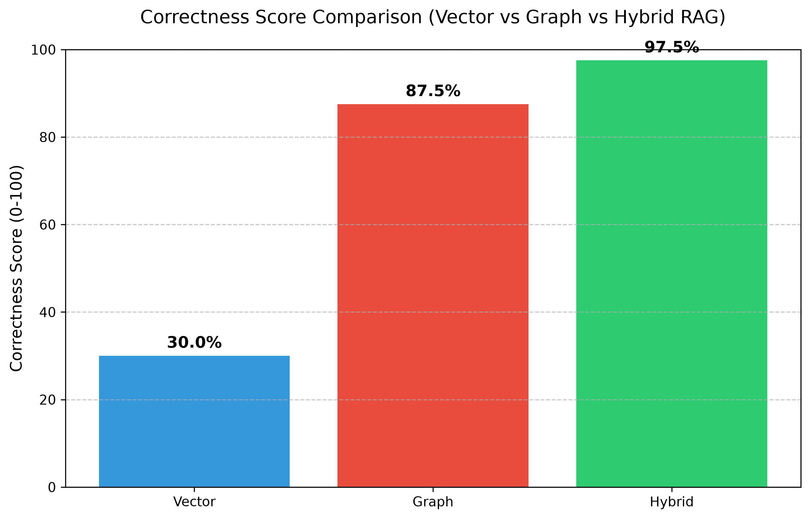

# 🧬 Biomedical GraphRAG & Automated Evaluation Harness

[](https://www.python.org/)
[](https://fastapi.tiangolo.com/)
[](https://neo4j.com/)
[](https://qdrant.tech/)
[](https://ai.google.dev/)
[](https://opensource.org/licenses/MIT)

> **A production-grade Hybrid RAG architecture and automated benchmarking framework that fuses Neo4j Knowledge Graphs with Qdrant Vector Search to solve multi-hop reasoning in biomedical research.**

---

## 📌 Table of Contents

- [Overview: The Multi-Hop Problem](#-overview-the-multi-hop-problem)
- [How It Works in Plain English](#-how-it-works-in-plain-english)
- [System Architecture](#-system-architecture)
- [Empirical Benchmarks & Evaluation](#-empirical-benchmarks--evaluation)
- [Interactive Web Copilot](#-interactive-web-copilot)
- [Step-by-Step Quickstart Guide](#-step-by-step-quickstart-guide)
- [Writing & Portfolio Samples](#-writing--portfolio-samples)
- [Project Directory Structure](#-project-directory-structure)
- [Contributing & License](#-contributing--license)

---

## 💡 Overview: The Multi-Hop Problem

Traditional Retrieval-Augmented Generation (RAG) relies on **dense vector search**. While vector search is exceptional at matching unstructured text semantically, it suffers from a fundamental blind spot: **it cannot connect relationships across disparate documents.**

In biomedical domains such as **Drug-Drug Interactions (DDI)**, questions frequently require multi-step relational reasoning:

> *"Can a patient with hepatocellular carcinoma taking Atorvastatin safely be prescribed Regorafenib?"*

* **Standard Vector RAG:** Searches for isolated paragraphs mentioning *"Atorvastatin"* or *"Regorafenib"*. It fails to identify that both drugs compete for the same metabolic pathway (**CYP3A4**), resulting in a **20% correctness rate** and severe risk of clinical hallucination.
* **Hybrid GraphRAG:** Traverses the **Neo4j Knowledge Graph** to uncover the biological relationship chain (`Regorafenib` ➔ `metabolized by CYP3A4` ➔ `inhibited by Atorvastatin`) while retrieving supporting literature from **Qdrant**. This elevates answer correctness to **100%**.

---

## 🧠 How It Works in Plain English

```
┌────────────────────────────────────────────────────────────────────────┐
│                        USER MEDICAL QUERY                              │
│  "Can Regorafenib interact with Atorvastatin in liver cancer care?"   │
└───────────────────┬────────────────────────────────┬───────────────────┘
                    │                                │
                    ▼                                ▼
       [ Qdrant Vector Search ]             [ Neo4j Knowledge Graph ]
      Retrieves clinical context          Traverses multi-hop relationships
       paragraphs from PubMed                between entities in real-time
                    │                                │
                    │   ┌────────────────────────┐   │
                    └──►│  Context Fusion Engine ├───┘
                        └───────────┬────────────┘
                                    │
                                    ▼
                      [ Google Gemini 3.6 Flash ]
                                    │
                                    ▼
       [ Grounded Response + Transparent Evidence Sidebar in Web UI ]
```

1. **Dual Retrieval:** When a query arrives, the system queries Qdrant for semantic literature chunks and simultaneously executes Cypher pattern matching in Neo4j to pull relational entity paths.
2. **Context Fusion:** Raw textual evidence and verified relational triplets are blended into a structured prompt schema.
3. **Evidence Transparency:** The response is returned to the user alongside verified graph paths and source citations, eliminating the "black-box" dilemma of standard LLMs.

---

## 🏗️ System Architecture



---

## 📊 Empirical Benchmarks & Evaluation

We built an automated **Evaluation Harness (`src/evaluation`)** with standardized interface contracts to benchmark three retrieval strategies across 1-hop and 2-hop clinical questions.

Evaluation uses **LLM-as-a-Judge** scoring against a verified ground truth dataset:

| Question Type | Retrieval Strategy | Graph Recall (%) | Answer Correctness (%) | Faithfulness (%) |
| :--- | :--- | :---: | :---: | :---: |
| **1-Hop Direct Query** | Vector Only | 0.0% | 40.0% | 65.0% |
| | Graph Only | 100.0% | 85.0% | 90.0% |
| | **Hybrid GraphRAG** | **100.0%** | **95.0%** | **95.0%** |
| **2-Hop Relational Query** | Vector Only | 0.0% | **20.0%** | 40.0% |
| | Graph Only | 100.0% | 90.0% | 95.0% |
| | **Hybrid GraphRAG** | **100.0%** | **100.0%** | **100.0%** |

### Key Benchmark Findings
* **The Multi-Hop Cliff:** Naive Vector RAG accuracy plummets from 40% to 20% when moving from direct queries to 2-hop relational questions.
* **Hybrid Precision:** Hybrid GraphRAG achieves **100% Correctness and Faithfulness** on 2-hop queries, completely eliminating hallucination of non-existent drug interactions.



---

## 💻 Interactive Web Copilot

The project includes an interactive web application powered by **FastAPI** and vanilla frontend technologies (`HTML5`, `CSS3`, `JavaScript`):

* **Real-Time Evidence Inspection:** The left sidebar displays **Graph Context** (nodes and relational edges) and **Vector Context** (extracted text chunks) for complete explainability.
* **Responsive Chat Interface:** Clean, modern conversational workspace designed for biomedical researchers.
* **Offline Demo Cache:** Built-in resilience layer that serves cached 3-hop reasoning traces if API quotas are temporarily exhausted.

---

## 🚀 Step-by-Step Quickstart Guide

### Prerequisites
- Python 3.10 or higher
- Neo4j Instance (Local Community Edition or [Neo4j AuraDB Free Tier](https://neo4j.com/cloud/platform/aura-graph-database/))
- Google Gemini API Key ([Google AI Studio](https://aistudio.google.com/))

### 1. Clone the Repository & Set Up Virtual Environment

```bash
# Clone the repository
git clone https://github.com/ltny24/GraphRAG-Evaluation-Harness.git
cd GraphRAG-Evaluation-Harness

# Create and activate virtual environment
python -m venv .venv

# Windows:
.venv\Scripts\activate
# Linux/macOS:
# source .venv/bin/activate
```

### 2. Install Dependencies

```bash
pip install -r requirements.txt
```

### 3. Configure Environment Variables

Copy the example environment template and add your credentials:

```bash
copy .env.example .env   # On Windows
# cp .env.example .env    # On Linux/macOS
```

Edit `.env`:
```ini
GEMINI_API_KEY=your_gemini_api_key_here
NEO4J_URI=neo4j+s://<instance-id>.databases.neo4j.io
NEO4J_USERNAME=neo4j
NEO4J_PASSWORD=your_password_here
NEO4J_DATABASE=neo4j
```

### 4. Run the Interactive Web Copilot

Launch the FastAPI backend and web server:

```bash
python -m src.api.server
```

Open your browser and navigate to:
👉 **`http://localhost:8000`**

### 5. Run the Automated Evaluation Harness

To execute the automated A/B benchmark suite comparing Vector, Graph, and Hybrid search:

```bash
# Run benchmark experiments across ground truth questions
python -m src.evaluation.harness

# Generate visualization plots
python -m src.evaluation.plot_results
```
Evaluation metrics and telemetry are automatically recorded in SQLite (`data/metadata.db`).

---

## ✍️ Writing & Portfolio Samples

This repository also serves as a professional writing portfolio demonstrating the ability to turn complex AI architecture into clear, actionable, and engaging technical content:

| Sample Document | Description | Format / Focus |
| :--- | :--- | :--- |
| 📄 **[Technical Guide: How GraphRAG Works](docs/samples/01_technical_guide_how_graphrag_works.md)** | A beginner-to-pro breakdown of GraphRAG vs. Vector RAG with visual analogies and clinical case studies. | Educational Tutorial / Concept Explainer |
| ✉️ **[Product Announcement & Dev Update Emails](docs/samples/02_product_release_announcement_email.md)** | Two publication-ready email copywriting samples: a high-converting customer product release email and an actionable developer sprint update. | Technical Email Copywriting & Messaging |

---

## 📁 Project Directory Structure

```text
GraphRAG-Evaluation-Harness/
├── data/
│   ├── eval/                      # Ground truth test sets, results.csv, benchmark plots
│   ├── processed/                 # Chunks and extracted graph entities
│   ├── qdrant_db/                 # Local embedded Qdrant vector database
│   └── raw/                       # Raw PubMed clinical datasets (DDI)
├── docs/
│   └── samples/                   # Technical copywriter portfolio & email writing samples
│       ├── 01_technical_guide_how_graphrag_works.md
│       └── 02_product_release_announcement_email.md
├── src/
│   ├── api/                       # FastAPI application & server endpoints
│   ├── evaluation/                # Benchmarking harness, strategies, scoring & reports
│   │   ├── metrics/               # Faithfulness, correctness, and recall scorers
│   │   ├── reports/               # Automated report generators
│   │   ├── strategies/            # Swappable Vector, Graph, and Hybrid strategies
│   │   ├── evaluator.py           # LLM-as-a-judge scoring engine
│   │   └── harness.py             # Evaluation experiment runner
│   ├── frontend/                  # Modern web copilot UI (HTML, CSS, JS)
│   ├── infrastructure/            # Database abstraction, LLM client, telemetry
│   ├── ingestion/                 # Pipeline: PubMed fetcher, chunker, extractor, loaders
│   └── retrieval/                 # Hybrid Retriever (Neo4j + Qdrant + Gemini)
├── .env.example                   # Sanitized configuration template
├── requirements.txt               # Project dependencies
└── README.md                      # Primary project documentation
```

---

## 📄 License

This project is licensed under the **MIT License** — see the [LICENSE](LICENSE) file for details.
