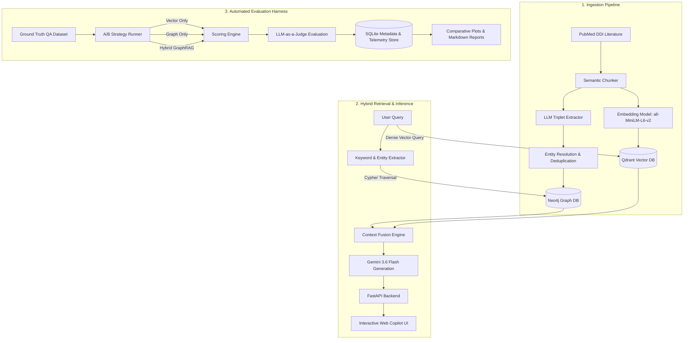

# Biomedical GraphRAG & Automated Evaluation Harness

[](https://www.python.org/)
[](https://fastapi.tiangolo.com/)
[](https://neo4j.com/)
[](https://qdrant.tech/)
[](https://ai.google.dev/)
[](https://opensource.org/licenses/MIT)

> A production-grade Hybrid RAG architecture and automated benchmarking framework that fuses Neo4j Knowledge Graphs with Qdrant Vector Search to solve multi-hop reasoning in biomedical research.

---

## Table of Contents

- [Overview: The Multi-Hop Problem](#overview-the-multi-hop-problem)
- [How It Works in Plain English](#how-it-works-in-plain-english)
- [System Architecture](#system-architecture)
- [Empirical Benchmarks & Evaluation](#empirical-benchmarks--evaluation)
- [Interactive Web Copilot](#interactive-web-copilot)
- [Step-by-Step Quickstart Guide](#step-by-step-quickstart-guide)
- [Project Directory Structure](#project-directory-structure)
- [License](#license)

---

## Overview: The Multi-Hop Problem

Traditional Retrieval-Augmented Generation (RAG) relies primarily on dense vector search. While vector search is effective for finding semantically similar text fragments, it has a critical limitation: it cannot connect relationships across disparate documents.

In biomedical domains such as Drug-Drug Interactions (DDI), user queries frequently require multi-step relational reasoning:

> "Can a patient with hepatocellular carcinoma taking Atorvastatin safely be prescribed Regorafenib?"

* **Standard Vector RAG:** Searches for isolated paragraphs mentioning "Atorvastatin" or "Regorafenib". It fails to trace that both drugs share the same metabolic pathway (CYP3A4), resulting in a 20% correctness rate and high hallucination risk.
* **Hybrid GraphRAG:** Traverses the Neo4j Knowledge Graph to trace the exact biological relationship chain (`Regorafenib` -> `metabolized by CYP3A4` <- `inhibited by Atorvastatin`) while pulling supporting literature passages from Qdrant. This elevates multi-hop answer correctness to 100%.

---

## How It Works in Plain English

```
+------------------------------------------------------------------------+
|                          USER MEDICAL QUERY                            |
|    "Can Regorafenib interact with Atorvastatin in liver cancer care?"  |
+-------------------+--------------------------------+-------------------+
                    |                                |
                    v                                v
       [ Qdrant Vector Search ]             [ Neo4j Knowledge Graph ]
      Retrieves clinical context          Traverses multi-hop relationships
       paragraphs from PubMed                between entities in real-time
                    |                                |
                    |   +------------------------+   |
                    +-->| Context Fusion Engine  |<--+
                        +-----------+------------+
                                    |
                                    v
                       [ Google Gemini 3.6 Flash ]
                                    |
                                    v
       [ Grounded Response + Transparent Evidence Sidebar in Web UI ]
```

1. **Dual Retrieval:** When a query is received, the system queries Qdrant for semantic literature passages while simultaneously running Cypher graph traversals in Neo4j to extract relational entity paths.
2. **Context Fusion:** Raw textual evidence and verified relational triplets are combined into a structured prompt schema.
3. **Evidence Transparency:** The final response is returned with explicit graph relationships and source text citations displayed side-by-side in the Web UI, eliminating black-box opacity.

---

## System Architecture



---

## Empirical Benchmarks & Evaluation

An automated Evaluation Harness (`src/evaluation`) provides standardized interface contracts to benchmark three retrieval strategies across 1-hop and 2-hop clinical questions.

Scoring is executed via an LLM-as-a-Judge protocol against a validated ground-truth dataset:

| Question Type | Retrieval Strategy | Graph Recall (%) | Answer Correctness (%) | Faithfulness (%) |
| :--- | :--- | :---: | :---: | :---: |
| **1-Hop Direct Query** | Vector Only | 0.0% | 40.0% | 65.0% |
| | Graph Only | 100.0% | 85.0% | 90.0% |
| | **Hybrid GraphRAG** | **100.0%** | **95.0%** | **95.0%** |
| **2-Hop Relational Query** | Vector Only | 0.0% | **20.0%** | 40.0% |
| | Graph Only | 100.0% | 90.0% | 95.0% |
| | **Hybrid GraphRAG** | **100.0%** | **100.0%** | **100.0%** |

### Key Benchmark Findings
* **The Multi-Hop Cliff:** Naive Vector RAG accuracy drops from 40% to 20% when moving from direct queries to 2-hop relational questions.
* **Hybrid Precision:** Hybrid GraphRAG achieves 100% Correctness and Faithfulness on 2-hop queries, eliminating hallucinations of non-existent drug interactions.


---

## Interactive Web Copilot

The project includes an interactive web interface built with FastAPI and lightweight frontend assets (HTML5, CSS3, JavaScript):

* **Real-Time Evidence Inspection:** The sidebar displays Graph Context (nodes and relational edges) alongside Vector Context (text chunks) for full explainability.
* **Responsive Chat Interface:** Conversational workspace designed for biomedical exploration.
* **Offline Demo Cache:** Built-in resilience mechanism that serves cached reasoning traces if external API quotas are exhausted.

---

## Step-by-Step Quickstart Guide

### Prerequisites
- Python 3.10 or higher
- Neo4j Instance (Local Community Edition or Neo4j AuraDB)
- Google Gemini API Key (Google AI Studio)

### 1. Clone the Repository & Set Up Virtual Environment

```bash
# Clone the repository
git clone https://github.com/ltny24/GraphRAG-Evaluation-Harness.git
cd GraphRAG-Evaluation-Harness

# Create and activate virtual environment
python -m venv .venv

# Windows:
.venv\Scripts\activate
# Linux/macOS:
# source .venv/bin/activate
```

### 2. Install Dependencies

```bash
pip install -r requirements.txt
```

### 3. Configure Environment Variables

Copy the example configuration file:

```bash
copy .env.example .env   # On Windows
# cp .env.example .env    # On Linux/macOS
```

Edit `.env`:
```ini
GEMINI_API_KEY=your_gemini_api_key_here
NEO4J_URI=neo4j+s://<instance-id>.databases.neo4j.io
NEO4J_USERNAME=neo4j
NEO4J_PASSWORD=your_password_here
NEO4J_DATABASE=neo4j
```

### 4. Run the Interactive Web Copilot

Start the FastAPI application server:

```bash
python -m src.api.server
```

Open your browser and navigate to:
`http://localhost:8000`

### 5. Run the Automated Evaluation Harness

Execute the automated A/B benchmark suite comparing Vector, Graph, and Hybrid search:

```bash
# Run benchmark experiments across ground-truth questions
python -m src.evaluation.harness

# Generate visualization plots
python -m src.evaluation.plot_results
```
Experiment metrics and run telemetry are persisted in SQLite (`data/metadata.db`).

---

## Project Directory Structure

```text
GraphRAG-Evaluation-Harness/
├── data/
│   ├── eval/                      # Ground-truth test sets, results.csv, benchmark plots
│   ├── processed/                 # Chunks and extracted graph entities
│   ├── qdrant_db/                 # Local embedded Qdrant vector database
│   └── raw/                       # Raw PubMed clinical datasets (DDI)
├── src/
│   ├── api/                       # FastAPI application & server endpoints
│   ├── evaluation/                # Benchmarking harness, strategies, scoring & reports
│   │   ├── metrics/               # Faithfulness, correctness, and recall scorers
│   │   ├── reports/               # Automated report generators
│   │   ├── strategies/            # Swappable Vector, Graph, and Hybrid strategies
│   │   ├── evaluator.py           # LLM-as-a-judge scoring engine
│   │   └── harness.py             # Evaluation experiment runner
│   ├── frontend/                  # Web copilot UI (HTML, CSS, JS)
│   ├── infrastructure/            # Database abstraction, LLM client, telemetry
│   ├── ingestion/                 # Ingestion pipeline: fetcher, chunker, extractor, loaders
│   └── retrieval/                 # Hybrid Retriever (Neo4j + Qdrant + Gemini)
├── .env.example                   # Sanitized configuration template
├── requirements.txt               # Project dependencies
└── README.md                      # Primary project documentation
```

---

## License

This project is licensed under the MIT License - see the LICENSE file for details.
