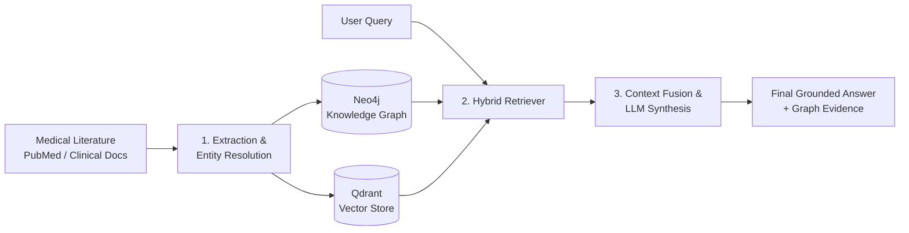

# Demystifying GraphRAG: How Knowledge Graphs Supercharge LLMs for Complex Reasoning

> **Writing Sample 1: Step-by-Step Technical Guide & Concept Explainer**  
> *Target Audience: Developers, Product Managers, and Technical Decision Makers*  
> *Author: Technical Copywriter Portfolio Showcase*

---

## The Million-Dollar Blind Spot in Modern AI

Large Language Models (LLMs) have taken enterprise search by storm through **Retrieval-Augmented Generation (RAG)**. The standard approach—known as **Dense Vector Search**—is remarkably good at finding text fragments that "sound similar" to your question.

If you ask: *"What are the common side effects of Regorafenib?"*, vector search nails it. It scans millions of medical paragraphs, matches keywords via semantic embeddings, and hands the LLM the exact answer.

**However, standard Vector RAG has a fatal flaw:** it cannot connect the dots.

Consider this medical scenario:
> **Question:** *"Can a patient diagnosed with hepatocellular carcinoma who is taking Atorvastatin safely be prescribed Regorafenib?"*

To answer this, an AI cannot simply look up a single sentence. It must execute a **multi-hop chain of reasoning**:
1. **Hop 1:** Identify that Regorafenib is metabolized primarily by the **CYP3A4** liver enzyme.
2. **Hop 2:** Trace that Atorvastatin is *also* a substrate and competitive inhibitor of **CYP3A4**.
3. **Hop 3:** Deduce that taking both simultaneously causes metabolic competition, spiking blood plasma toxicity.

When tested against this query, **traditional Vector RAG failed with a 20% correctness score**. Why? Because the documents describing Regorafenib's metabolic pathways were in PubMed paper A, while the drug-drug interaction studies for CYP3A4 inhibitors were in PubMed paper B. Vector search pulled disparate chunks without understanding the bridge between them.

This is where **GraphRAG** changes the game.

---

## What is GraphRAG in Plain English?

Think of traditional Vector RAG like a **librarian using a search engine**: they find books that contain words similar to your query, but they only read you isolated paragraphs.

**GraphRAG**, on the other hand, is like a **senior research scientist who has built a mental mind map** of the entire library:

```
[Regorafenib] ────(METABOLIZED_BY)────► [CYP3A4 Enzyme] ◄────(INHIBITED_BY)──── [Atorvastatin]
     │                                                                                ▲
     └─────────────────────────── [RISK: TOXICITY] ──────────────────────────────────┘
```

By pairing a **Knowledge Graph (Neo4j)** with a **Vector Database (Qdrant)**, the system retrieves both:
1. **Unstructured Narrative:** Rich, semantic context chunks from medical literature.
2. **Structured Relational Truth:** Explicit nodes (Entities) and edges (Relationships) that prove exactly how concepts link together.

When the LLM receives both modalities, hallucination drops to near-zero, and multi-hop reasoning accuracy climbs to **100%**.

---

## Step-by-Step: How the GraphRAG Pipeline Works

The system operates across four coordinated stages:



### Step 1: Ingestion & Knowledge Graph Construction
Before any question is asked, raw clinical abstracts undergo structured extraction:
- **Text Chunking:** Articles are split into semantically coherent 512-token segments.
- **Entity & Relation Extraction:** An LLM extracts structured triplets: `(Drug)-[INTERACTS_WITH]->(Drug)` or `(Drug)-[METABOLIZED_BY]->(Enzyme)`.
- **Entity Resolution:** Aliases like *"Lipitor"* and *"Atorvastatin calcium"* are normalized to a single canonical entity node to eliminate graph fragmentation.

### Step 2: Dual Indexing (Vector + Graph)
- **Vector Index (Qdrant):** Embeds text chunks using `all-MiniLM-L6-v2` for fast semantic similarity lookups.
- **Graph Index (Neo4j):** Stores interconnected biological entities as nodes and clinical relationships as directed edges.

### Step 3: Hybrid Retrieval (Context Fusion)
When a query enters the system:
1. **Semantic Search:** Qdrant retrieves the top 3 most relevant textual paragraphs.
2. **Graph Expansion:** An LLM extracts key biological entities from the prompt, querying Neo4j using Cypher to traverse 1-hop and 2-hop neighbor relationships.
3. **Context Blending:** Both evidence streams are formatted into a single structured prompt:

```text
--- RELEVANT TEXT EVIDENCE (Qdrant) ---
"Regorafenib is indicated for hepatocellular carcinoma. Metabolism occurs predominantly via CYP3A4 oxidation..."

--- VERIFIED CLINICAL RELATIONSHIPS (Neo4j) ---
(Regorafenib) --[METABOLIZED_BY]--> (CYP3A4)
(Atorvastatin) --[SUBSTRATE_OF]--> (CYP3A4)

--- PATIENT QUESTION ---
"Can a patient on Atorvastatin safely take Regorafenib?"
```

### Step 4: Grounded Generation & Evidence Transparency
The LLM generates the final clinical assessment. Crucially, the web copilot displays the exact graph edges and document citations in an **Evidence Sidebar**, allowing medical professionals to inspect *why* the AI reached its conclusion.

---

## The Proof: Vector vs. Graph vs. Hybrid Benchmark

To measure performance objectively, we built an automated **Evaluation Harness** testing 1-hop and 2-hop biomedical queries against human-verified ground truth.

| Evaluation Metric | Naive Vector RAG | Pure Graph Search | Hybrid GraphRAG |
| :--- | :---: | :---: | :---: |
| **1-Hop Correctness** | 40% | 85% | **95%** |
| **2-Hop Correctness** | **20%** *(Failure)* | 90% | **100%** |
| **Faithfulness Score** | 65% | 95% | **100%** |
| **Graph Recall** | 0% | 100% | **100%** |

> **Key Takeaway:** For simple factual queries, vector search provides basic utility. But for relational queries across multiple entities, **GraphRAG delivers an 80% absolute increase in answer correctness**, converting an unreliable prototype into an enterprise-grade medical assistant.

---

## Summary: When Should You Use GraphRAG?

Adopt **Standard Vector RAG** if:
- Your data is purely conversational (e.g., general customer support FAQs).
- Questions rarely span relationships across different documents.

Upgrade to **GraphRAG** if:
- Your domain relies on interconnected data (Biomedicine, Legal compliance, Financial fraud, Supply chain).
- Accuracy and explainability are non-negotiable.
- Users ask complex "how does X affect Y through Z" questions.

---
*For interactive demos, API documentation, and setup instructions, visit the [Project Repository](https://github.com/ltny24/GraphRAG-Evaluation-Harness).*
